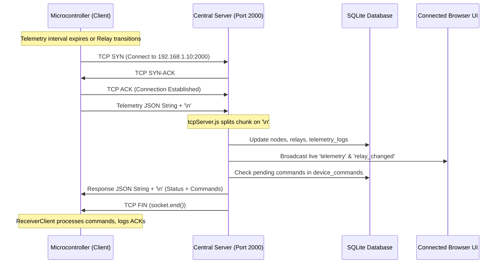

# RAW TCP SOCKET TELEMETRY PROTOCOL SPECIFICATION

**Port**: `2000`  
**Transport**: TCP Socket Stream  
**Framing**: Line-Delimited JSON (`\n` newline separator)  
**Encoding**: UTF-8  
**Server Component**: [`central_server_js/src/tcpServer.js`](file:///d:/ai/Homeautomation_server/central_server_js/src/tcpServer.js)  
**Client Component**: [`ReceiverClient`](file:///d:/ai/Homeautomation_server/esp8266_4mb/src/receiver_client.cpp)  

---

## 1. Connection Architecture & Directionality

> [!IMPORTANT]
> The **Central Server** is the **TCP Server** listening on `0.0.0.0:2000`.
> The **Microcontroller (NodeMCU / ESP-01)** is strictly an **outbound TCP Client** (`WiFiClient client; client.connect(serverHost, 2000)`).
> The microcontroller does **NOT** listen for inbound connections on port 2000. It opens a TCP socket to the Central Server, transmits telemetry, reads the server's reply on the same connection, and the connection is closed.



---

## 2. Telemetry Ingest Message Frame (Client $\rightarrow$ Server)

The client streams an unindented JSON payload terminated by `\n`:

```json
{"nodeId":"NODE-BCDDC223386C","nodeName":"SmartHome-01","eventType":"heartbeat","timestamp":"2026-11-07 00:25:00 (IST)","epoch":1793400900,"ip":"192.168.1.105","gateway":"192.168.1.1","mac":"BC:DD:C2:23:38:6C","rssi":-52,"uptimeSec":12480,"freeHeap":26840,"firmwareVersion":"1.6.0","token":"optional_token","channels":[{"id":1,"pin":5,"name":"Living Light","state":false}],"acks":[{"command_uuid":"7c9e6679-7425-40de-944b-e07fc1f90ae7","success":true,"status":"ACKNOWLEDGED"}]}
```

### Required Fields:
- `nodeId`: Unique hardware identifier (`NODE-` + MAC address).
- `eventType`: `"heartbeat"`, `"gpio_change"`, `"boot"`, `"test_ping"`, or `"manual_push"`.
- `uptimeSec`: Current node uptime in seconds. Drop in value indicates a node restart.
- `channels`: Array of current GPIO channel states.
- `acks`: (Optional) Application-level acknowledgements for commands executed by the node.

---

## 3. Server Response Frame (Server $\rightarrow$ Client)

The server evaluates pending commands for the calling `nodeId` in `device_commands` and responds with a JSON line:

```json
{"status":"ok","epoch":1793400901,"commands":[{"command_uuid":"1b9d6bcd-bbfd-4b2d-9b5d-ab8dfbbd4bed","action":"setState","id":1,"state":true}]}
```

### Supported Remote Actions:
1. `setState`: Sets relay logical state (`"id": 1, "state": true`).
2. `toggle`: Inverts current relay state (`"id": 1`).
3. `pulse`: Actuates relay for specified milliseconds (`"id": 1, "duration": 500`).
4. `reboot`: Instructs node to execute `ESP.restart()` after 500ms delay.

---

## 4. Socket Lifecycle & Timeout Specifications

- **Server Socket Timeout**: Configured in `tcpServer.js` line 19 as `socket.setTimeout(6000)`. If a client connects and sends no data for 6 seconds, the server terminates the socket.
- **Client Reply Timeout**: Configured in `receiver_client.cpp` line 131 as `1500 ms`. If the server fails to return an acknowledgment line within 1.5 seconds, the node marks the cycle as timed out and closes the socket.
- **Connection Teardown**: Server calls `socket.write(resp + '\n', () => socket.end())`, initiating a graceful half-close. Client reads EOF and executes `_tcpClient.stop(10)`.
