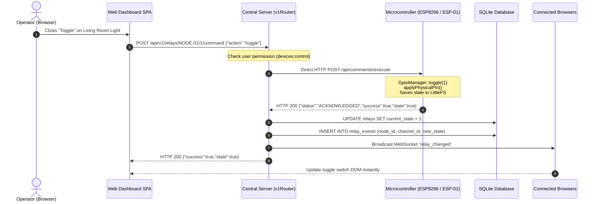
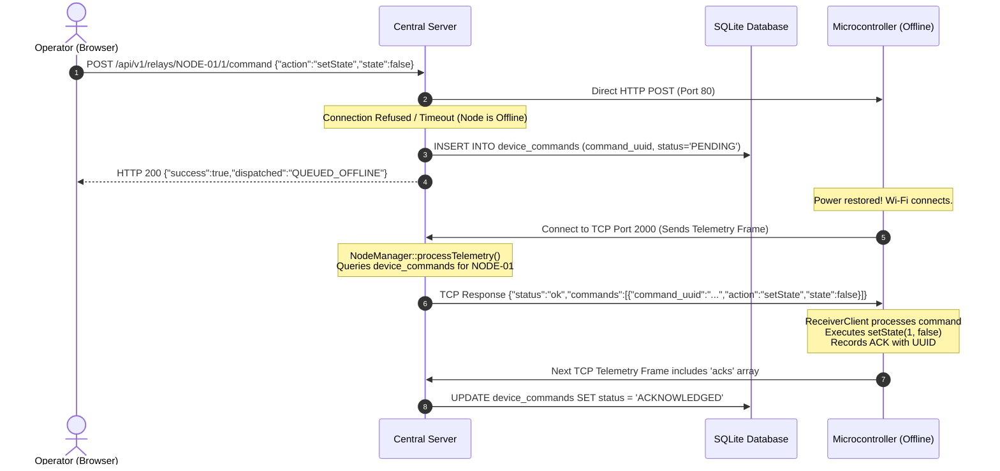
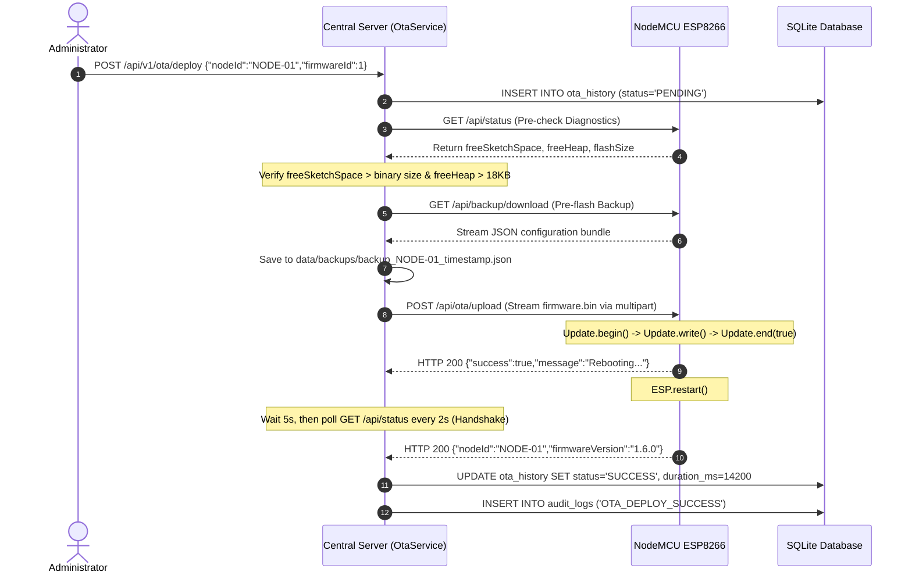

# END-TO-END DATA FLOW SEQUENCES

**Scope**: Step-by-Step Data Sequences for Critical System Use-Cases  

---

## 1. Flow 1: High-Frequency Relay Actuation Flow

When an operator clicks a relay toggle on the Web Dashboard:

---

## 2. Flow 2: Offline Command Queueing & Heartbeat Delivery

When a command is dispatched while the node is temporarily offline:

---

## 3. Flow 3: Managed Over-The-Air (OTA) Deployment Flow

