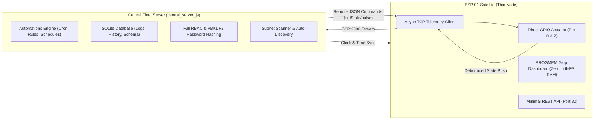

# DEVICE 03 FIRMWARE ARCHITECTURE: ESP-01 / ESP-01S (1MB)

**Architecture**: Streamlined Satellite Actuator  
**Source References**: [`esp01_1mb/src/automation.cpp`](file:///d:/ai/Homeautomation_server/esp01_1mb/src/automation.cpp), [`esp01_1mb/src/auth_manager.cpp`](file:///d:/ai/Homeautomation_server/esp01_1mb/src/auth_manager.cpp)  

---

## 1. Architectural Philosophy: The Lean Satellite

The ESP-01 microcontroller has severe physical resource limits (1MB flash total, max ~480 KB executable code space to preserve dual OTA update capability).

Rather than forcing complex subsystems onto the chip, Device 03 implements a **Satellite Offloading Strategy**:

---

## 2. Key Architectural Offloading Decisions

### A. Automation Engine Offloading
In [`esp01_1mb/src/automation.cpp`](file:///d:/ai/Homeautomation_server/esp01_1mb/src/automation.cpp#L5-L7):
- Daily cron schedules, time-of-day checks, and NTP synchronization loops are eliminated from the firmware.
- The firmware stubs out `AutomationEngine::loop()` and returns `outError = F("Automations managed by Central Server")`.
- When a GPIO pin changes state, `AutomationEngine::notifyGpioStateChanged()` immediately dispatches the event to `ReceiverClient` to notify the Central Server.

### B. PROGMEM Dashboard (Zero LittleFS Storage)
In [`esp01_1mb/src/web_server.cpp`](file:///d:/ai/Homeautomation_server/esp01_1mb/src/web_server.cpp#L501-L506):
- `/index.html` and `/` serve `DASHBOARD_HTML_GZ` directly from Flash ROM (PROGMEM).
- LittleFS is spared from storing bulky `.html`, `.js`, and `.css` files, allowing the LittleFS partition to be shrunk to a safe 64KB for configuration JSONs.

### C. Zero-Heap Static Allocation
In [`esp01_1mb/src/gpio_manager.h`](file:///d:/ai/Homeautomation_server/esp01_1mb/src/gpio_manager.h#L46):
- Dynamic `std::vector<GpioChannel>` is replaced by static `GpioChannel _channels[MAX_GPIO_CHANNELS]`.
- Eliminates heap fragmentation during channel lookups.

### D. Stripped Float Operations
Build script [`strip_floats.py`](file:///d:/ai/Homeautomation_server/esp01_1mb/strip_floats.py) and compiler flags (`ARDUINOJSON_USE_DOUBLE=0`) eliminate floating-point emulation libraries, saving ~14 KB of flash code space.
