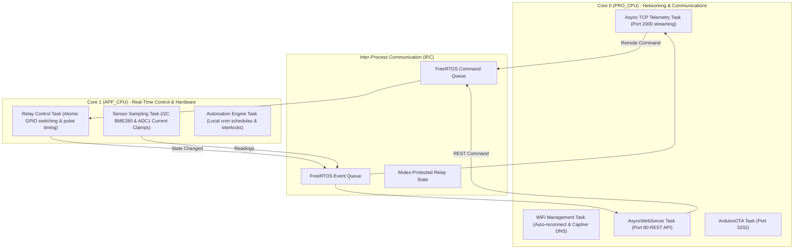

# DEVICE 02 TARGET FIRMWARE ARCHITECTURE: ESP32

**Target OS**: FreeRTOS Symmetric Multiprocessing (SMP)  
**Target Framework**: Arduino-ESP32 Core / ESP-IDF  
**Implementation Status**: Recommended Architectural Blueprint  

---

## 1. Dual-Core Task Allocation Architecture

Unlike the single-threaded ESP8266, the ESP32 should leverage both Xtensa LX6 cores via dedicated FreeRTOS tasks:



---

## 2. Recommended Partition Table (`default_4MB_dual_ota.csv`)

For an ESP32 with 4MB flash, dual OTA partitions provide fail-safe remote firmware upgrades:

```csv
# Name,   Type, SubType, Offset,  Size, Flags
nvs,      data, nvs,     0x9000,  0x5000,
otadata,  data, ota,     0xe000,  0x2000,
app0,     app,  ota_0,   0x10000, 0x140000,
app1,     app,  ota_1,   0x150000,0x140000,
spiffs,   data, spiffs,  0x290000,0x160000,
coredump, data, coredump,0x3F0000,0x10000,
```
- `app0` & `app1`: 1.25 MB each for active and staging OTA firmware binaries with automatic rollback on boot failure.
- `spiffs` / `littlefs`: ~1.37 MB for web assets and JSON configurations.
- `coredump`: Crash log storage for post-mortem debugging.
