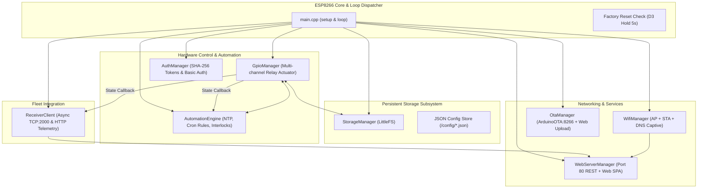

# DEVICE 01 FIRMWARE ARCHITECTURE: ESP8266 / NODEMCU (4MB)

**Firmware**: `SmartHome-NodeMCU v1.6.0`  
**Execution Model**: Cooperative Multitasking / Non-Blocking Single-Threaded Event Loop  
**Source References**: [`esp8266_4mb/src/main.cpp`](file:///d:/ai/Homeautomation_server/esp8266_4mb/src/main.cpp), [`config.h`](file:///d:/ai/Homeautomation_server/esp8266_4mb/src/config.h)  

---

## 1. High-Level Firmware Component Architecture

The firmware is designed in decoupled, singleton manager classes with clear ownership of system resources:



---

## 2. Startup Boot Sequence

The bootstrap sequence in [`setup()`](file:///d:/ai/Homeautomation_server/esp8266_4mb/src/main.cpp#L46-L99) follows strict dependency ordering:

1. **Serial & Hardware Pin Init**:
   - Initializes Serial UART @ 115200 baud.
   - Configures `FACTORY_RESET_PIN` (D3 / GPIO0) as `INPUT_PULLUP`.
   - Configures `ONBOARD_LED_PIN` (D4 / GPIO2) as `OUTPUT`, initially HIGH (LED OFF).
2. **Persistent Storage Init (`StorageManager::begin()`)**:
   - Mounts LittleFS filesystem. If mount fails, attempts formatting once.
3. **Authentication Init (`AuthManager::begin()`)**:
   - Loads admin username and SHA-256 password hash from `/config/system.json`.
4. **Relay State Change Hook Registration**:
   - Connects a lambda callback from `GpioManager` to `AutomationEngine` and `ReceiverClient`.
   - Enables immediate event-driven telemetry pushing and interlock execution whenever any relay pin transitions.
5. **Hardware GPIO Init (`GpioManager::begin()`)**:
   - Loads `/config/gpio.json`.
   - Restores power-loss pin states according to `initialMode` and applies physical pin voltages before configuring `OUTPUT` mode.
6. **Wi-Fi Subsystem Init (`WifiManager::begin()`)**:
   - Starts in configured mode (`WIFI_MODE_AP_ROUTER`, `WIFI_MODE_ROUTER_ONLY`, or `WIFI_MODE_AP_ONLY`).
   - If Station mode is enabled, initiates non-blocking connection to target home router.
   - Starts DNS Captive Portal server on port 53.
7. **Automation Engine Init (`AutomationEngine::begin()`)**:
   - Loads rules from `/config/rules.json`.
   - Starts NTP time client targeting `time.google.com`, `in.pool.ntp.org`, and `asia.pool.ntp.org` with IST (+05:30) offset.
8. **Telemetry Client Init (`ReceiverClient::begin()`)**:
   - Derives permanent unique hardware Node ID from MAC address eFuse (`NODE-XXXXXXXXXXXX`).
   - Loads `/config/receiver.json`.
9. **OTA Updates Init (`OtaManager::begin()`)**:
   - Starts ArduinoOTA server with hostname `SmartHome-Setup` (or configured SSID).
10. **Embedded Web Server Init (`WebServerManager::begin()`)**:
    - Registers all REST API endpoints, captive portal fallbacks, and static file handlers.
    - Starts HTTP listener on port 80.

---

## 3. Cooperative Execution Loop (`loop()`)

The ESP8266 executes a single thread without FreeRTOS tasks. The main `loop()` sequentially calls non-blocking update routines:

```cpp
void loop() {
    WifiManager::getInstance().loop();        // Handles DNS captive requests & STA auto-reconnect
    WebServerManager::getInstance().loop();   // Processes inbound HTTP requests (client.handleClient())
    GpioManager::getInstance().loop();        // Monitors active non-blocking pulse timers
    AutomationEngine::getInstance().loop();   // Checks auto-off timers & 1Hz schedule ticks
    ReceiverClient::getInstance().loop();     // Non-blocking async TCP telemetry state machine
    OtaManager::getInstance().loop();         // ArduinoOTA.handle()
    checkResetButton();                       // Samples D3 GPIO0 hold duration (5s trigger)
    yield();                                  // Yields control to ESP8266 WiFi stack & software WDT
}
```

> [!IMPORTANT]
> No blocking delays (`delay()`) exist in normal operation loops. All timings use `millis()` arithmetic. `yield()` is explicitly invoked to prevent ESP8266 software watchdog timer (WDT) resets.
