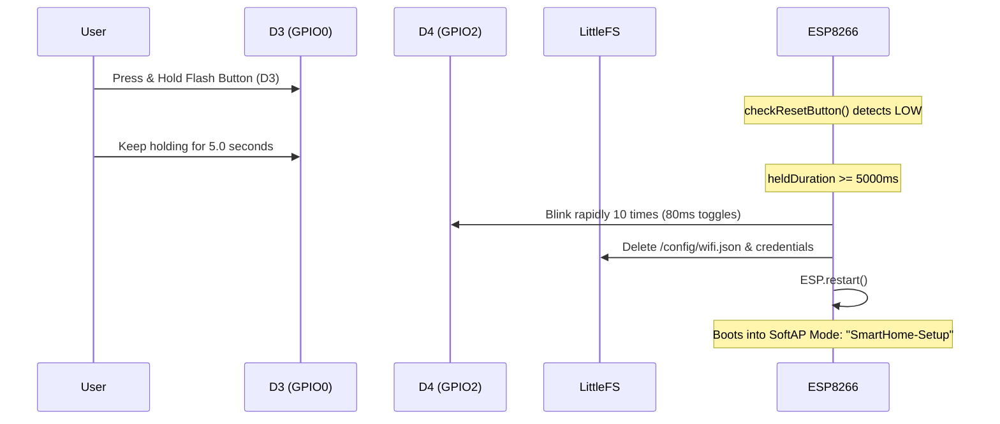

# DEVICE 01 TROUBLESHOOTING & RECOVERY: ESP8266 / NODEMCU (4MB)

**Reference**: Diagnostic Routines, Reset Vectors, and Recovery Protocols  

---

## 1. Physical Hardware Recovery (5-Second Factory Reset)

If the device is configured with an invalid Wi-Fi network, wrong static IP, or forgotten password, use the physical recovery button:



### Steps:
1. Locate the **FLASH** button on the NodeMCU board (D3 / GPIO0).
2. Press and hold the button continuously for **5 full seconds**.
3. Observe the blue onboard LED (D4 / GPIO2) blinking rapidly 10 times.
4. Release the button. The NodeMCU erases Wi-Fi credentials and automatically restarts.
5. On boot, connect your laptop/phone to the open Wi-Fi network: **`SmartHome-Setup`** (IP: `192.168.4.1`).

---

## 2. Bootloader Reset Reason Diagnostics

On boot, `ESP.getResetReason()` is recorded and exposed via `/api/status`. Common codes:

| Reset Reason | Cause | Corrective Action |
|---|---|---|
| `Power on` | Normal power-up cycle | None required. |
| `Hardware Watchdog` | CPU starved in a tight loop for > 3.2 seconds without yielding | Inspect custom loops; ensure `yield()` is called. |
| `Fatal exception` | Memory access violation, null pointer, unaligned read | Check stack trace using ESP Exception Decoder. |
| `Software Watchdog` | Loop stalled for > 1.6 seconds without calling `delay()` or `yield()` | Check long string concatenations or network calls. |
| `Software / System restart` | Deliberate restart triggered via `ESP.restart()` | Expected after OTA flash or factory reset. |
| `Deep-Sleep Wake` | Wakeup via GPIO16 (D0) tied to RST | Verify jumper wire if deep sleep is configured. |

---

## 3. Common Failure Modes & Solutions

### A. Device Fails to Boot / Endless Blue LED Strobe
- **Cause**: Bootstrapping pins are in invalid states during power-up.
  - GPIO15 (D8) is pulled HIGH externally.
  - GPIO0 (D3) or GPIO2 (D4) is grounded externally.
- **Solution**: Disconnect relay boards or sensor inputs from D3, D4, and D8 during boot. Use safe pins (D1, D2, D5, D6, D7) for relay triggers.

### B. "Flash storage initialization failed!" on Serial Console
- **Cause**: LittleFS partition is unformatted or corrupted due to power failure during a write.
- **Solution**: The firmware will attempt auto-formatting. If it fails, run:
  ```powershell
  pio run -e nodemcuv2 --target uploadfs
  ```
  to re-image the LittleFS partition.

### C. Web Dashboard Shows 404 for style.css / app.js
- **Cause**: LittleFS filesystem image was not uploaded to flash.
- **Solution**: The firmware serves the fallback embedded dashboard (`dashboard_html.h`), but for the full UI, execute `pio run -e nodemcuv2 --target uploadfs`.

### D. Central Server Shows Node "Offline"
- **Cause**: Outbound TCP port 2000 is blocked by Windows Defender Firewall on the server PC, or node IP configuration is mismatched.
- **Solution**:
  1. Verify the central server host IP in `/config/receiver.json`.
  2. On the server machine, verify port 2000 is listening: `netstat -ano | findstr 2000`.
  3. Ensure inbound TCP port 2000 is allowed in Windows Firewall.
