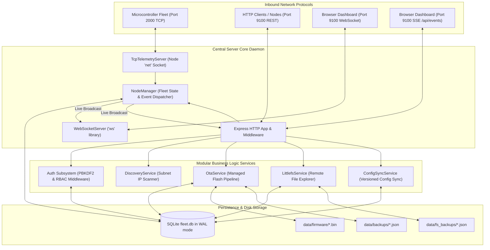

# CENTRAL SERVER BACKEND ARCHITECTURE

**Framework**: Node.js v20+ / Express v4.21.2  
**Architecture**: Service-Oriented Event-Driven Architecture with Background Workers  
**Source Directory**: [`central_server_js/src/`](file:///d:/ai/Homeautomation_server/central_server_js/src)  

---

## 1. High-Level Subsystem Flow

---

## 2. Background Workers & Periodic Polling Engines

The Central Server runs two independent background timer engines inside `NodeManager`:

### A. Offline Watcher (`startOfflineWatcher()`)
- **Interval**: Executes every 4,000 ms (4 seconds).
- **Evaluation**: Compares `Date.now() / 1000 - node.last_seen_epoch` against `config.offline_timeout_sec` (default 30 seconds).
- **Transition Behavior**: When a node exceeds the timeout:
  1. Sets `node.is_online = 0` in SQLite `nodes` table.
  2. Logs an audit entry: `NODE_OFFLINE`.
  3. Records a system event with `WARNING` severity.
  4. Broadcasts a `node_status` event via WebSocket and SSE to immediately gray out the node on operator screens.
  5. Pushes a system notification to the topbar alert center.

### B. Periodic Status & Pin Poller (`startPeriodicStatusPoller()`)
- **Interval**: Configurable via `poll_interval_sec` (default 10 seconds). Can be disabled via `poll_enabled: false`.
- **Purpose**: Actively queries each registered online node via direct HTTP `GET /api/status` and `GET /api/gpio`.
- **Resilience**: Prevents the dashboard from becoming desynchronized if a node's outbound TCP telemetry packet is lost or dropped by network congestion.
- **Immediate Trigger**: Can be manually triggered at any second via `POST /api/v1/system/poll-now` or clicking the topbar sync pill.
