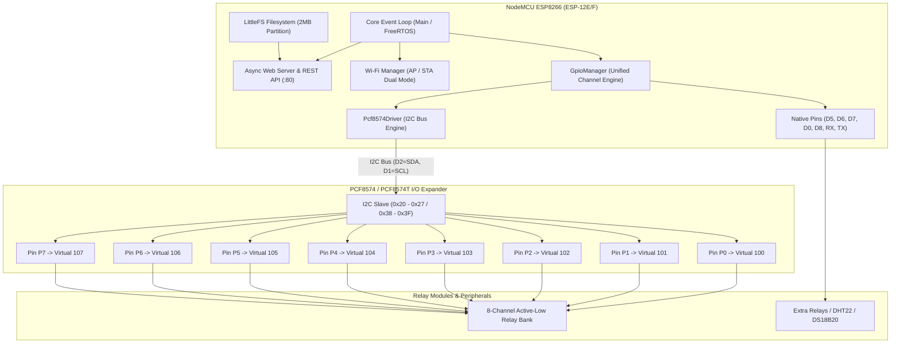

# 🔌 SmartHome Controller - NodeMCU ESP8266 + PCF8574 / PCF8574T I2C Expander (4MB Flash)

[](https://platformio.org/)
[-blue.svg)](https://www.espressif.com/)
[](https://www.ti.com/lit/ds/symlink/pcf8574.pdf)
[-yellowgreen.svg)](#flash-memory-architecture)
[](#features)

A modular, enterprise-grade smart-home automation controller firmware for the **NodeMCU ESP8266 (ESP-12E / ESP-12F, 4MB Flash)** paired with the **PCF8574 / PCF8574T / PCF8574A 8-bit I2C I/O Expander**.

By interfacing the PCF8574T over the clean, boot-neutral I2C bus (**`D2` = SDA [GPIO 4]**, **`D1` = SCL [GPIO 5]**), this firmware extends the NodeMCU to support **8 isolated optical relay channels** (`P0` to `P7`, mapped to virtual pins `100` to `107`) with zero boot clicking or relay chatter, while keeping **11 native NodeMCU GPIO pins** available for extra relays, temperature/humidity sensors (DHT22, DS18B20), motion sensors (PIR), or physical switches.

---

## 📑 Table of Contents

- [🌟 Features](#-features)
- [🏗️ System Architecture](#️-system-architecture)
- [🔌 Hardware Wiring Guide](#-hardware-wiring-guide)
  - [NodeMCU to PCF8574T Pinout](#nodemcu-to-pcf8574t-pinout)
  - [Why D2 (GPIO 4) & D1 (GPIO 5) Are the Standard I2C Pins](#why-d2-gpio-4--d1-gpio-5-are-the-standard-i2c-pins)
  - [I2C Address Jumpers Matrix](#i2c-address-jumpers-matrix)
- [🕹️ PCF8574 Virtual Pin Mapping & Relay Logic](#️-pcf8574-virtual-pin-mapping--relay-logic)
  - [Virtual Pin Routing](#virtual-pin-routing)
  - [Active-Low Relay Logic & Register Bitmask](#active-low-relay-logic--register-bitmask)
- [📌 Remaining Available Native NodeMCU GPIO Pins](#-remaining-available-native-nodemcu-gpio-pins)
- [🔍 Dynamic I2C Scanner & Address Resolution](#-dynamic-i2c-scanner--address-resolution)
- [🌐 REST API Reference](#-rest-api-reference)
  - [System & Status](#system--status)
  - [I2C Diagnostics](#i2c-diagnostics)
  - [Authentication](#authentication)
  - [GPIO & Relay Control](#gpio--relay-control)
  - [Wi-Fi Network Management](#wi-fi-network-management)
  - [Central Receiver / Multi-Node Telemetry](#central-receiver--multi-node-telemetry)
  - [Over-The-Air (OTA) Firmware Upload](#over-the-air-ota-firmware-upload)
- [💻 Web Dashboard Overview](#-web-dashboard-overview)
- [🚀 Building, Flashing & Updating](#-building-flashing--updating)
  - [1. Prerequisites](#1-prerequisites)
  - [2. Compile Firmware](#2-compile-firmware)
  - [3. Build LittleFS Filesystem](#3-build-littlefs-filesystem)
  - [4. Flash via USB Cable](#4-flash-via-usb-cable)
  - [5. Wireless HTTP Web OTA Update](#5-wireless-http-web-ota-update)
- [🔧 Troubleshooting & Diagnostics](#-troubleshooting--diagnostics)

---

## 🌟 Features

1. **8 Extended Relay Channels via PCF8574 / PCF8574T**:
   - Seamlessly auto-probes and detects both **PCF8574 / PCF8574T** (`0x20`–`0x27`) and **PCF8574A / PCF8574AT** (`0x38`–`0x3F`). Zero hardcoding required.
   - Virtual pin numbering (`100` = P0, `101` = P1 ... `107` = P7) integrated into the core `GpioManager`.
   - Native active-low optical relay drive without clicking, chatter, or boot-up glitches.
   - Automatic I2C error recovery and bus re-arbitration if wires are disturbed or power is cycled.

2. **Self-Contained Wi-Fi Management**:
   - **First-Boot Captive Portal**: Boots into Access Point mode (`SmartHome-NodeMCU-PCF8574`) at `http://192.168.4.1/`.
   - **3 Operation Modes**: `AP ONLY`, `ROUTER ONLY`, and `AP + ROUTER` (Concurrent dual-mode).
   - **Failsafe Recovery**: If connection to the home router is lost, the AP is automatically revived so you never get locked out.
   - **Physical Factory Reset**: Holding the Flash button (`D3` / GPIO 0) for 5 seconds clears Wi-Fi credentials with visual LED confirmation.

3. **High-Performance LittleFS Web Dashboard**:
   - Zero external cloud or internet required. Completely hosted locally from the 2MB LittleFS partition.
   - Single-Page Responsive Application (mobile smartphone, tablet, desktop).
   - Real-time PCF8574 hardware diagnostics card showing I2C address, bus status, and live 8-bit output mask.
   - Interactive relay control with configurable pulse timers (inching mode) and channel labeling.

4. **Automation Engine & Multi-Node Central Server Sync**:
   - Built-in time-of-day schedules, sunrise/sunset offsets, and inter-channel linked rules.
   - Real-time bidirectional telemetry streaming over async TCP or HTTP REST to central server controllers.
   - Full REST API with self-documenting discovery catalog at `/api/all`.

---

## 🏗️ System Architecture



---

## 🔌 Hardware Wiring Guide

### NodeMCU to PCF8574T Pinout

| NodeMCU Pin | ESP8266 GPIO | PCF8574T Pin | Description | Required Pull-up |
|---|---|---|---|---|
| **`D2`** | **GPIO 4** | **SDA** | I2C Serial Data | Built-in software pull-up + module pull-ups (4.7kΩ) |
| **`D1`** | **GPIO 5** | **SCL** | I2C Serial Clock | Built-in software pull-up + module pull-ups (4.7kΩ) |
| **`3V3`** or **`VIN`** | 3.3V / 5.0V | **VCC** | Power Supply | 3.3V recommended (5V tolerant if module has 3.3V pull-ups) |
| **`GND`** | GND | **GND** | Ground Rail | Common GND between NodeMCU, PCF8574, and Relay board |

> [!NOTE]
> If driving 5V relay coils, power the relay board VCC from **`VIN`** (5V from USB / 5V DC adapter), but ensure the **GND** is common with the NodeMCU. PCF8574 inputs and outputs easily interface with standard optical isolator inputs on active-low relay boards.

---

### Why D2 (GPIO 4) & D1 (GPIO 5) Are the Standard I2C Pins

The ESP8266 has specific hardware boot strapping pins that must be in designated states when power is applied or the reset button is released:

| Pin | GPIO | Boot Role | Why NOT for I2C? |
|---|---|---|---|
| **D3** | GPIO 0 | Boot Mode Select (SPI vs UART download) | Tied to NodeMCU Flash button. Must be held HIGH for normal boot. Placing I2C pull-ups or slave devices here introduces capacitive loading and risks dropping into UART download mode. |
| **D4** | GPIO 2 | Boot Diagnostic / TXD1 | Tied to the onboard Blue LED. Must stay HIGH at boot. The LED pull-up causes parasitic impedance that corrupts fast I2C clock timing. |
| **D8** | GPIO 15 | Boot Mode Select | Must be pulled LOW at boot. If an I2C pull-up resistor pulls this pin HIGH, the ESP8266 will completely refuse to boot. |
| **`D2`** | **GPIO 4** | **Pure Neutral I/O** | **NO boot strapping dependencies. Clean, high-impedance, ideal for I2C SDA.** |
| **`D1`** | **GPIO 5** | **Pure Neutral I/O** | **NO boot strapping dependencies. Clean, high-impedance, ideal for I2C SCL.** |

Therefore, **`D2` (SDA)** and **`D1` (SCL)** are the standard, robust pins for I2C communication on all ESP8266 NodeMCU hardware.

---

### I2C Address Jumpers Matrix

The PCF8574 module allows selecting one of 8 distinct hardware addresses via jumpers `A0`, `A1`, and `A2`:

#### Standard PCF8574 / PCF8574T (Default chip on most relay & LCD backpacks):
| A2 | A1 | A0 | Hex Address | Binary Address |
|:---:|:---:|:---:|:---:|:---:|
| **0 (GND)** | **0 (GND)** | **0 (GND)** | **`0x20`** *(Observed on standard modules)* | `0b0100000` |
| 0 (GND) | 0 (GND) | 1 (VCC) | **`0x21`** | `0b0100001` |
| 0 (GND) | 1 (VCC) | 0 (GND) | **`0x22`** | `0b0100010` |
| 0 (GND) | 1 (VCC) | 1 (VCC) | **`0x23`** | `0b0100011` |
| 1 (VCC) | 0 (GND) | 0 (GND) | **`0x24`** | `0b0100100` |
| 1 (VCC) | 0 (GND) | 1 (VCC) | **`0x25`** | `0b0100101` |
| 1 (VCC) | 1 (VCC) | 0 (GND) | **`0x26`** | `0b0100110` |
| **1 (VCC)** | **1 (VCC)** | **1 (VCC)** | **`0x27`** *(Default with unbridged solder pads)* | `0b0100111` |

#### PCF8574A / PCF8574AT Variant:
- Addresses range from **`0x38`** (A2=0, A1=0, A0=0) to **`0x3F`** (A2=1, A1=1, A0=1).

> [!TIP]
> You do **not** need to manually edit code if you change jumpers! The firmware dynamically scans all addresses between `0x20`–`0x27` and `0x38`–`0x3F` upon boot.

---

## 🕹️ PCF8574 Virtual Pin Mapping & Relay Logic

### Virtual Pin Routing

To make relay control intuitive in the web interface and REST API, the firmware maps the 8 PCF8574 output pins to virtual pin IDs starting at **`100`**:

| PCF Pin | Virtual Pin ID | Channel ID | Default Relay Name | Polarity | Electrical State When ON |
|:---:|:---:|:---:|:---:|:---:|:---:|
| **P0** | **`100`** | 1 | Relay 1 | Active-Low | 0V (LOW) |
| **P1** | **`101`** | 2 | Relay 2 | Active-Low | 0V (LOW) |
| **P2** | **`102`** | 3 | Relay 3 | Active-Low | 0V (LOW) |
| **P3** | **`103`** | 4 | Relay 4 | Active-Low | 0V (LOW) |
| **P4** | **`104`** | 5 | Relay 5 | Active-Low | 0V (LOW) |
| **P5** | **`105`** | 6 | Relay 6 | Active-Low | 0V (LOW) |
| **P6** | **`106`** | 7 | Relay 7 | Active-Low | 0V (LOW) |
| **P7** | **`107`** | 8 | Relay 8 | Active-Low | 0V (LOW) |

---

### Active-Low Relay Logic & Register Bitmask

Most standard 4-channel and 8-channel relay modules are **Active-Low**:
- **ON (Energized)**: Input is pulled to **GND (0V / LOW)** -> Optocoupler LED conducts -> Relay closes.
- **OFF (De-energized)**: Input is pulled to **VCC (3.3V/5V / HIGH)** -> Optocoupler LED is dark -> Relay opens.

#### Boot State Safety (Zero Clicking):
During power-up, the firmware immediately sets the 8-bit PCF8574 register to:
```text
0xFF = 0b11111111 (Decimal: 255) -> All 8 pins HIGH -> All relays safely OFF
```

#### Output Register Mask in Action:
When toggling relays via the dashboard or API, the firmware computes the bitwise state mask:
- **All Relays OFF**: `0b11111111` (`255` / `0xFF`)
- **Relay 1 ON**: `0b11111110` (`254` / `0xFE`)
- **Relay 1 & Relay 3 ON**: `0b11111010` (`250` / `0xFA`)
- **All Relays ON**: `0b00000000` (`0` / `0x00`)

The live bitmask is reported in the Web Dashboard and returned by `/api/status` under the field `"pcf8574Output"`.

---

## 📌 Remaining Available Native NodeMCU GPIO Pins

Because the PCF8574 only consumes 2 pins (`D2` and `D1`), all other NodeMCU GPIOs remain fully available for extra relays or sensors:

| Pin | GPIO | Recommended Use | Boot Notes & Electrical Behavior |
|:---:|:---:|:---:|---|
| **`D5`** | GPIO 14 | Extra Relay / Sensor / DHT22 | **Safe General I/O**. Boot-neutral, standard SPI CLK. |
| **`D6`** | GPIO 12 | Extra Relay / Sensor / DS18B20 | **Safe General I/O**. Boot-neutral, standard SPI MISO. |
| **`D7`** | GPIO 13 | Extra Relay / Sensor / PIR | **Safe General I/O**. Boot-neutral, standard SPI MOSI. |
| **`D0`** | GPIO 16 | Extra Relay / Status Indicator | Safe general output. Pulled HIGH at boot; tied to WAKE circuit. |
| **`D8`** | GPIO 15 | Extra Relay (Active-High preferred) | Boot pin: must be LOW at boot. Do not connect active-low relay with strong pull-up here. |
| **`D3`** | GPIO 0 | Factory Reset Button (Hold 5s) | NodeMCU Flash button. Must be HIGH at boot. |
| **`D4`** | GPIO 2 | Onboard Blue LED Status | Linked to ESP-12 onboard blue LED. Active-Low. |
| **`RX`** | GPIO 3 | Extra Input / Serial Debug | UART0 RX pin. Usable as GPIO if Serial logging is disabled. |
| **`TX`** | GPIO 1 | Extra Output / Serial Debug | UART0 TX pin. Glitches HIGH during boot logging. |
| **`SD2`** | GPIO 9 | Extra Input / Output | Usable when flash is flashed in DIO or DOUT mode. |
| **`SD3`** | GPIO 10 | Extra Input / Output | Usable when flash is flashed in DIO or DOUT mode. |

> Up to **24 total channels** (`MAX_GPIO_CHANNELS = 24`) can be simultaneously managed in the dashboard!

---

## 🔍 Dynamic I2C Scanner & Address Resolution

The controller features an integrated I2C scanner engine. You can verify all connected I2C devices at any time without recompiling or rebooting.

### Testing the I2C Bus via REST API:

```http
GET /api/i2c/scan HTTP/1.1
Host: 192.168.1.102
```

#### Response Example (PCF8574 Detected):
```json
{
  "sdaPin": 4,
  "sclPin": 5,
  "sdaDigitalLevel": 1,
  "sclDigitalLevel": 1,
  "devices": [
    "0x20"
  ],
  "count": 1,
  "applied": false
}
```

#### Dynamically Rebinding the Bus:
You can probe alternative pins or force the driver to re-bind to the first detected address on the fly:
```http
GET /api/i2c/scan?sda=4&scl=5&apply=1 HTTP/1.1
```

---

## 🌐 REST API Reference

### System & Status

#### `GET /api/status`
Returns real-time hardware telemetry, memory, Wi-Fi stats, and PCF8574 status.
- **Authentication**: None required.
- **Response**:
```json
{
  "deviceName": "SmartHome NodeMCU",
  "firmwareVersion": "1.6.0",
  "hardware": "ESP8266 NodeMCU + PCF8574T",
  "uptimeSec": 1420,
  "freeHeap": 26840,
  "minFreeHeap": 25112,
  "heapFragPercent": 14,
  "flashSize": 4194304,
  "fsTotal": 2072576,
  "fsUsed": 348160,
  "fsFree": 1724416,
  "fsPercent": 16,
  "wifiMode": 2,
  "staConnected": true,
  "staSsid": "MyHomeWifi",
  "staIp": "192.168.1.102",
  "rssi": -48,
  "pcf8574Detected": true,
  "pcf8574Address": "0x20",
  "pcf8574Output": 254
}
```

#### `GET /api/all`
Returns the complete machine-readable self-discovery API catalog listing all supported REST routes.

---

### Authentication

#### `POST /api/auth/login`
Authenticates a user session.
- **Payload**:
```json
{
  "username": "admin",
  "password": "admin"
}
```
- **Response**: Returns HTTP 200 with session cookie (`Set-Cookie: session=...`) and auth token:
```json
{
  "success": true,
  "token": "a1b2c3d4e5...",
  "username": "admin"
}
```

---

### GPIO & Relay Control

#### `GET /api/gpio`
Returns the list of all configured channels, current states, and pin mappings.

#### `POST /api/gpio/state`
Controls or toggles an output channel.
- **Headers**: `Content-Type: application/json`, `Cookie: session=<token>` (or HTTP Basic Auth).
- **Direct State Control**:
```json
{
  "id": 1,
  "state": true
}
```
- **Toggle Action**:
```json
{
  "id": 1,
  "action": "toggle"
}
```
- **Timed Pulse (Inching / Momentary Switch)**:
```json
{
  "id": 1,
  "action": "pulse",
  "duration": 1000
}
```

#### `POST /api/gpio`
Adds a new relay or sensor channel.
```json
{
  "pin": 100,
  "name": "Living Room Light",
  "room": "Living Room",
  "function": "Relay",
  "activeLow": true,
  "initialMode": 0
}
```

---

### Wi-Fi Network Management

- `GET /api/wifi/status` - Current Wi-Fi state, connection mode, IP, RSSI.
- `GET /api/wifi/scan` - Scans all available 2.4GHz Wi-Fi networks.
- `POST /api/wifi/connect` - Saves router credentials and connects:
  ```json
  {
    "ssid": "MyHomeNetwork",
    "password": "SecretPassword123"
  }
  ```
- `POST /api/wifi/mode` - Sets Wi-Fi operation mode (`0` = AP Only, `1` = Router Only, `2` = AP + Router):
  ```json
  {
    "mode": 2
  }
  ```
- `POST /api/wifi/reset` - Clears stored router credentials and restarts into Setup AP mode.

---

### Central Receiver / Multi-Node Telemetry

- `GET /api/receiver` - Inspects multi-node telemetry synchronization parameters.
- `POST /api/receiver` - Configures central server host/port and push frequency:
  ```json
  {
    "enabled": true,
    "serverHost": "192.168.1.100",
    "serverPort": 8080,
    "intervalSec": 30
  }
  ```
- `POST /api/receiver/test` - Pings the central server.
- `POST /api/receiver/push` - Forces an immediate telemetry transmission.

---

### Over-The-Air (OTA) Firmware Upload

#### `POST /api/ota/upload`
Uploads a compiled firmware binary (`firmware.bin`) or filesystem binary (`littlefs.bin`) over HTTP.
- **Content-Type**: `multipart/form-data`
- **Requires Authentication**: Yes.

---

## 💻 Web Dashboard Overview

The web dashboard is fully embedded in the 2MB LittleFS filesystem and provides:

1. **System Overview**: Live cards showing CPU load, Uptime, Free Heap, Flash usage, and Wi-Fi signal strength.
2. **PCF8574 Expander Diagnostics Card**:
   - Live I2C connection status badge (**CONNECTED** vs **DISCONNECTED**).
   - Detected I2C address (e.g. `0x20` or `0x27`).
   - Real-time 8-bit output mask in hexadecimal and decimal format.
3. **Relay Controls**:
   - 8 pre-configured tiles for PCF8574 channels (Relay 1 – Relay 8).
   - Toggle buttons with instant state feedback.
   - Channel renaming, room assignment, and timer configuration.
4. **Channel Configuration Modal**:
   - Interactive pin selector featuring dedicated visual badges for PCF8574 expander pins (`P0`–`P7`) and native NodeMCU GPIOs (`D5`, `D6`, `D7`, etc.).
5. **System Logs & Diagnostics**: Live 50-entry circular log stream.

---

## 🚀 Building, Flashing & Updating

### 1. Prerequisites
Ensure [PlatformIO Core (CLI)](https://platformio.org/install/cli) is installed.
Default executable path on Windows:
```powershell
& "C:\Users\TUSAR\.platformio\penv\Scripts\pio.exe" --version
```

### 2. Compile Firmware
Navigate to the project root directory and run:
```powershell
& "C:\Users\TUSAR\.platformio\penv\Scripts\pio.exe" run -d "node mcu and pcf8574 t"
```
**Output binary**: `node mcu and pcf8574 t/.pio/build/nodemcuv2/firmware.bin` (~494 KB)

### 3. Build LittleFS Filesystem
Compile the web dashboard and configuration files into the LittleFS binary:
```powershell
& "C:\Users\TUSAR\.platformio\penv\Scripts\pio.exe" run -t buildfs -d "node mcu and pcf8574 t"
```
**Output binary**: `node mcu and pcf8574 t/.pio/build/nodemcuv2/littlefs.bin` (~2,072 KB)

---

### 4. Flash via USB Cable

> [!WARNING]
> Before running USB flash commands, **close all Serial Monitors** (Arduino IDE, PuTTY, VS Code Serial Monitor) on your COM port! Otherwise, you will encounter:
> `PermissionError(13, 'Access is denied')`.

```powershell
# 1. Flash Firmware to NodeMCU
& "C:\Users\TUSAR\.platformio\penv\Scripts\pio.exe" run -t upload -d "node mcu and pcf8574 t"

# 2. Flash Web Dashboard (LittleFS)
& "C:\Users\TUSAR\.platformio\penv\Scripts\pio.exe" run -t uploadfs -d "node mcu and pcf8574 t"
```

---

### 5. Wireless HTTP Web OTA Update

If the device is already installed in your home or connected to Wi-Fi, you can update it wirelessly without touching a USB cable:

#### Method A: Via Web Browser (Recommended)
1. Open `http://<device-ip>/` (e.g. `http://192.168.1.102/` or `http://192.168.4.1/`).
2. Log in with admin credentials (`admin` / `admin`).
3. Click the **Firmware** tab in the sidebar.
4. Drag and drop `firmware.bin` (or `littlefs.bin`) and click **Start Update**.
5. The device will flash the partition, reboot automatically, and restore your previous channel states.

#### Method B: Via PowerShell / cURL Command Line
```powershell
# Step 1: Authenticate and store session cookie
curl.exe -c cookie.txt -X POST http://192.168.1.102/api/auth/login `
  -H "Content-Type: application/json" `
  -d '{\"username\":\"admin\",\"password\":\"admin\"}'

# Step 2: Upload firmware binary over HTTP OTA
curl.exe -b cookie.txt -F "file=@node mcu and pcf8574 t/.pio/build/nodemcuv2/firmware.bin" `
  http://192.168.1.102/api/ota/upload

# Step 3: Remove cookie
Remove-Item cookie.txt
```

---

## 🔧 Troubleshooting & Diagnostics

### 1. PCF8574 Expander Shows "DISCONNECTED" or Address 0x00
- **Check Wiring**: Ensure **`D2`** is connected to **`SDA`** and **`D1`** is connected to **`SCL`**.
- **Check Wires**: Jumper wires frequently suffer from loose Dupont crimps. Swap wires or test with a multimeter.
- **Run Live Bus Scan**: Visit `http://<device-ip>/api/i2c/scan` in your browser.
  - If `devices` array is `[]`, verify that VCC has 3.3V or 5V and GND is connected.
  - If `sdaDigitalLevel` or `sclDigitalLevel` reports `0`, one line is shorted to ground or missing a pull-up resistor.

### 2. Relays are ON when Web Dashboard shows OFF
- Standard optical relay boards are **Active-Low**.
- In the channel configuration modal, ensure the **Active-Low** switch is turned **ON** (`activeLow: true`).

### 3. Flash Upload Fails with "Access is denied" on COM Port
- Another application is holding the serial port open (VS Code Serial Monitor, Arduino Serial Monitor, or PuTTY).
- Close the monitor or use wireless HTTP OTA instead.

### 4. NodeMCU Fails to Boot (Blue LED On Solid / Boot Loop)
- Check whether any external sensor or relay is connected to **`D3` (GPIO 0)**, **`D4` (GPIO 2)**, or **`D8` (GPIO 15)**.
- If `D8` is pulled HIGH at boot, or `D3` / `D4` are pulled LOW at boot, the ESP8266 enters bootloader flash mode or crashes.
- Move peripherals to safe pins: **`D5` (GPIO 14)**, **`D6` (GPIO 12)**, or **`D7` (GPIO 13)**.

### 5. Forgot Wi-Fi Password or Router Unreachable
- The controller will automatically broadcast its recovery hotspot: `SmartHome-NodeMCU-PCF8574` at `http://192.168.4.1/`.
- Alternatively, hold the physical **Flash Button** (`D3` / GPIO 0) on the NodeMCU for **5 continuous seconds**. The onboard blue LED will blink rapidly, wiping stored Wi-Fi credentials and resetting to default AP mode.

---

## 📄 License & Credits

- Developed for the **SmartHome Controller Ecosystem**.
- Built with **PlatformIO**, **Arduino Core for ESP8266**, and **ArduinoJson**.
- Designed for reliable 24/7 standalone smart home automation.
